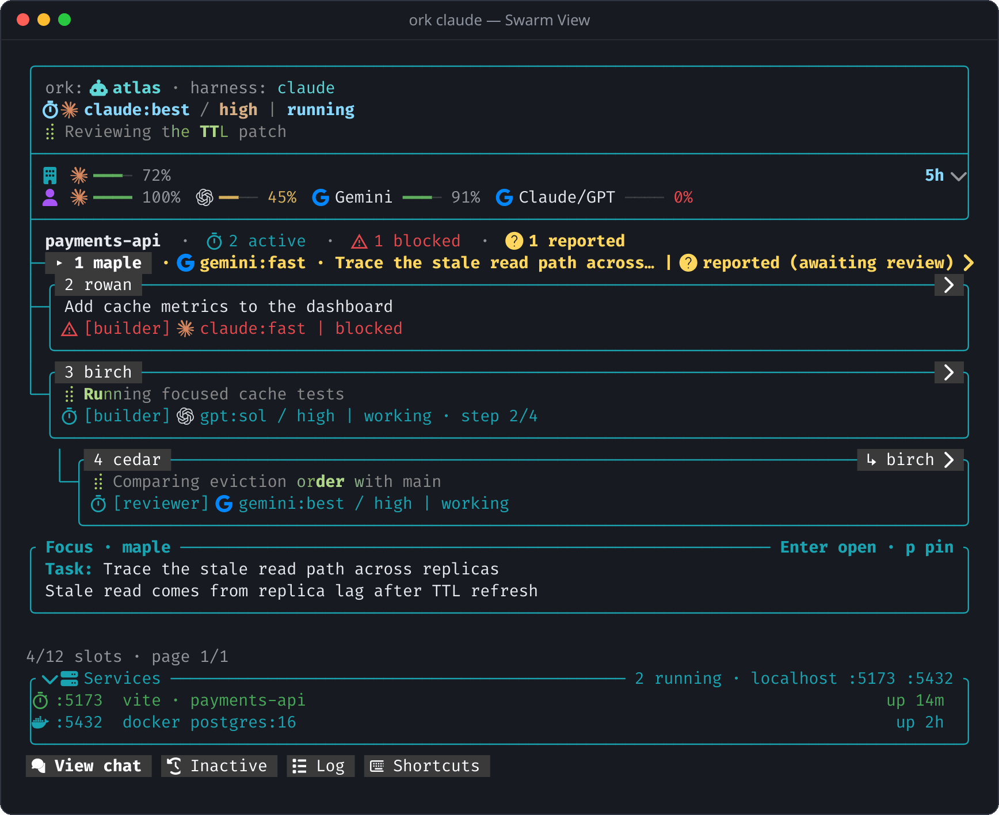
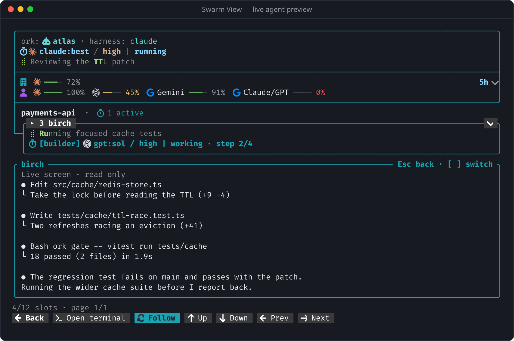
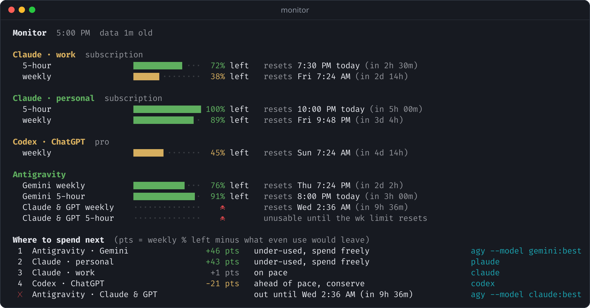

# Orkest

Run Claude Code, Codex, Antigravity, and OpenCode together on one codebase without losing track of
who is doing what, burning the wrong account's quota, or stepping on each other's files.



You keep working in your normal harness CLI. Orkest sits beside it:

- **A live swarm tree** of native subagents and cross-harness workers, with each agent's model,
  role, stage and outcome.
- **Bounded delegation**: workers get a file scope, a worktree lease and verification that runs
  outside the model. Work is "reported" until the coordinator reviews and accepts it.
- **Second opinions** from another vendor's model, read-only.
- **Quota awareness** across every account, so work goes where there is headroom.
- **Guardrails**: per-repository account rules, and a shared gate so parallel agents don't run
  five test suites at once.

## Quick start

After [installing](#install), from any repository:

```sh
ork claude     # or: ork codex, ork agy, ork opencode
```

That opens your harness with room tracking attached. Describe your goal in the conversation; the
coordinator plans, assigns workers and reviews their results. Toggle the Swarm View beside it with
`/swarm` (or `ork swarm`).

To start from an objective or a team preset instead:

```sh
ork horde "Find out why the cache goes stale and prepare a tested fix"
ork horde --preset bug-court "Race condition in session refresh"
ork horde --team "claude:haiku*2@scout,codex:sol@builder,agy:flash@reviewer"
```

## What you can do

### Watch and steer a swarm

The Swarm View groups agents by folder and disposable worktree, and updates as they work. Select
an agent to read its live terminal without leaving your conversation:



| Key       | Action                                                 |
| --------- | ------------------------------------------------------ |
| `1`–`9`   | Focus an agent                                         |
| `Enter`   | Open the focused agent's live preview                  |
| `o`       | Jump to the agent's Herdr or tmux pane                 |
| `p` / `n` | Pin the detail panel / next page                       |
| `u` / `w` | Expand quota details / switch 5-hour and weekly meters |
| `v`       | Running dev servers, ports and containers              |
| `c`       | Show or hide inactive agents                           |
| `g` / `?` | Room log / all shortcuts                               |
| `m`       | Toggle mouse capture, to select text                   |
| `U`       | Apply an Orkest update when one is announced           |
| `q`       | Close the view; workers keep running                   |

Reconnect from any terminal with `ork horde --attach-room <id>`; add `--view` to only observe.
Details: [conversational swarms](plugins/orchestrate/skills/orchestrate/references/swarm.md).

### Fire off side missions

When you notice an unrelated bug mid-session, hand it off without spending your main agent's
context or dirtying the checkout:

```sh
/side "fix the off-by-one error in pagination"       # background worker in its own worktree
/side "why does token refresh retry twice?"          # read-only scout (trailing ? or --investigate)
/side --later "flatten the retry helper after this PR lands"   # park a note on the workboard
/side --issue "support dark mode in the status modal"          # file a GitHub issue
```

### Ask another model

`consult` runs a different vendor's model in its no-write mode, for a review or a root-cause
investigation that doesn't hand over file ownership. Agents call it on their own when a second
opinion adds confidence.

```sh
python3 ~/.agents/skills/orchestrate/scripts/run_agent.py consult --intent review \
  --read . --diff origin/main \
  --question "Any race conditions or missed edge cases?" --model gpt:sol
```

Model selectors such as `gpt:sol`, `claude:best` and `gemini:fast` resolve against each CLI's live
catalog, so a model release needs no config change. `ork routes` shows which model each kind of
task goes to, and `ork radar` reports new models and ones whose pass rate has dropped.

### Know where your quota is

[`monitor`](plugins/monitor/README.md) reads the 5-hour and weekly windows, reset times and credit
balances of every account from the CLIs you already have, at no token cost, and ranks where to
spend next:



The same data feeds the Swarm View meters, a macOS menu bar app, a KDE Plasma widget, and an MCP
server (`get_usage`, `recommend`) that coordinators consult before routing work.

### Keep agents inside the lines

```sh
ork policy deny claude-work      # on a personal repo: never bill the work profile
ork policy deny opencode         # on a work repo: no open-weight routes
ork policy show
```

Policy is checked before any CLI is started. `ork gate` does the same for machine load: focused
test runs share two slots, and a `--heavy` run (whole suite, build, typecheck) waits for an
exclusive lock, caps test workers and saves its full log.

```sh
ork gate -- ./node_modules/.bin/vitest run tests/cache-test.js
ork gate --heavy -- pnpm test
```

### Turn spare quota into merged work

- **`ork foundry`** picks up ready GitHub issues when `monitor` shows quota that would expire
  unused, and dispatches bounded workers into disposable worktrees.
- **`ork smelter`** rebases each finished worktree, audits its scope, runs the heavy gate, gets a
  cross-vendor cold review, then fast-forwards or opens a pull request.
- **`ork next`** loops through both, and stops for your sign-off only on a conflict or a
  high-risk change.

## Reference

Every `ork` command:

<!-- generated:commands -->

```text
ork agy|codex|claude|opencode   (open a coordinator; enter your goal in the conversation)
  --harness-arg=<argument>      (pass an argument to the coordinator; repeat as needed)
ork horde ["objective"] [--engine codex|claude|agy|opencode] [--max-agents 12] [--max-depth 3]
ork horde [toggle|open|close]   (open or close the live Horde / Swarm View split pane)
ork horde [--team "claude:haiku*2@scout,agy:flash*2@builder,codex:luna:max@reviewer"]
ork horde --preset scout-swarm|bug-court|patch-race|heavy-trifecta
ork horde spawn --attach-room <id> --team <team> [--role <role>]
ork horde --attach-room <id> [--view|--print|--json]
ork horde --fixture <room.json> [--print|--json] [--width 120]
ork hall --help                 (manage swarm rooms, members, leads, roles, and dispatches)
ork next [step|status|settle|loop] [--room <id>] [--approve <slug>] [--dry-run] [--json]
ork foundry [status|run|groom] [--dry-run] [--json]
ork smelter [status|run] [--dry-run] [--json]
ork side [run|status] [--prompt <text>] [--issue <n>] [--dry-run] [--json]
ork cleanup [status|run] [--dry-run] [--json]
ork policy [show|allow|deny|reset] [--json]
ork update [--check|--apply] [--json]
ork radar [--line|--json] [--refresh]
ork gate [--heavy] [--label <text>] -- <command>   (also: ork gate status|install|uninstall)
ork swarm [toggle|open|close]   (alias for ork horde toggle|open|close)
ork factory [status|run|groom] [--dry-run] [--json]   (alias for ork foundry)
ork rooms --help                (alias for ork hall)
ork herdr-status                     (focused Herdr pane agent, plain text)
ork setup [--dry-run] [--trust-codex-hooks]   (install mailbox, hooks and shell wrapper shortcuts)
ork label [--lines 1|2] -- codex|claude|agy|opencode [arguments]   (direct in Herdr; tmux footer elsewhere)
ork progress --session ID --goal TEXT --task TEXT --stage working [--role ROLE]
ork name [--model <model>] [--effort <level>] [--harness <harness>] [--short]
ork routes [--archetype <name>] [--json] [--width 120]
ork quota [--line|--json] [--refresh]
ork telemetry [--runs-dir <directory>] [--json] [--width 120]
```

<!-- /generated:commands -->

Slash commands, in any harness that loads the plugin:

<!-- generated:slash-commands -->

- `/cleanup [status|run] [--dry-run] [--migrate-legacy]`: Audit, prune, and migrate legacy Orkest / agent-executor state, worktrees, and backups
- `/horde [toggle|open|close|<goal>]`: Toggle the Orkest Swarm View split pane or launch a swarm for a goal
- `/side [--later|--issue|--investigate] <idea>`: Launch or park a side mission from the current tab without derailing your main task
- `/swarm [toggle|open|close|<goal>]`: Toggle the Orkest Swarm View split pane or launch a swarm for a goal
- `/update [run|check|status|enable|disable] [--auto] [--force] [--quiet] [--json]`: Check for and apply fast-forward Orkest updates, refresh mailbox hooks, and migrate legacy agent-executor state

<!-- /generated:slash-commands -->

## Plugins

The repository ships two plugins. Their READMEs cover every flag, routing table and setup option:

| Plugin                                         | Version | What it does                                                       |
| ---------------------------------------------- | ------- | ------------------------------------------------------------------ |
| [`orchestrate`](plugins/orchestrate/README.md) | 0.76.9  | Coordinator conversations, swarms, delegation and shared work.     |
| [`monitor`](plugins/monitor/README.md)         | 0.18.0  | Account quota, reset times, credit balances and spending guidance. |

More: [architecture and module map](docs/ARCHITECTURE.md), [Herdr integration](docs/herdr.md),
[all documentation](docs/README.md).

## Install

<!-- generated:requirements -->

Requires Git, Node.js 26.13+, Python 3.11+, `tmux`, and at least one installed, authenticated harness CLI (`claude`, `codex`, `agy`, or `opencode`).

<!-- /generated:requirements -->

```sh
git clone https://github.com/loftshed/orkest.git ~/src/orkest
cd ~/src/orkest

# orchestrate: skills, peer-mailbox MCP server, hooks, and the ork CLI
./plugins/orchestrate/install.sh
mkdir -p ~/.local/bin
ln -sf "$PWD/plugins/orchestrate/bin/ork.mjs" ~/.local/bin/ork

# monitor: CLI, MCP server, and the macOS menu bar app (--no-app for the CLI only)
./plugins/monitor/install.sh
monitor mcp-install
```

Make sure `~/.local/bin` is on your `PATH`, then check the setup:

```sh
python3 ~/.agents/skills/orchestrate/scripts/run_agent.py doctor --check-messaging
```

Orkest runs from this checkout, with no build step. `ork update` (or `/update`) fast-forwards it
and refreshes the hooks; `ork cleanup status` previews stale worktrees, locks and backups.

Optional setup:

- **Codex turn hooks:** run `ork setup --trust-codex-hooks`, or approve them once in Codex `/hooks`.
- **Claude Code plugin** instead of linked skills: see the
  [orchestrate install options](plugins/orchestrate/README.md#install).
- **Status footer** outside `ork` launches: see
  [terminal footer setup](plugins/orchestrate/README.md#agent-status-in-terminal-footers).
- **Herdr:** pane labels, the swarm pane and layout restoration are covered in
  [Herdr integration](docs/herdr.md).
- **KDE Plasma widget:** `sh plugins/monitor/linux/install.sh`.

## Development

```sh
corepack pnpm install
ork gate --heavy -- ./scripts/check.sh
ork gate --heavy -- ./scripts/test.sh
```

Run focused tests while editing (`./node_modules/.bin/vitest run <test-file>` or
`python3 -m unittest <test-file>`) and the heavy gate once at the end. Conventions are in
[CLAUDE.md](CLAUDE.md); releases are automatic from conventional commits, see
[docs/releases.md](docs/releases.md).

The command lists and screenshots in this file are generated. After changing a command, a slash
command or the terminal UI, run `corepack pnpm readme`; the lint gate fails while they are stale.
See [docs/readme.md](docs/readme.md).

### Troubleshooting

- **Corepack reports a missing `pnpm.cjs`:** update Corepack on a supported Node.js version. CI
  pins Corepack 0.36.0.
