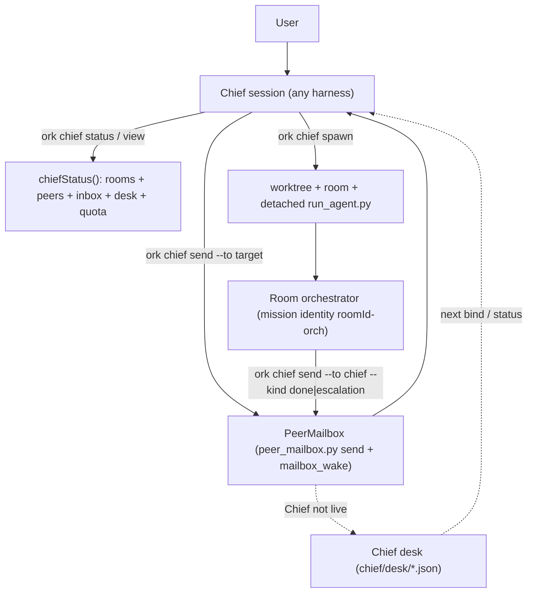

# Ork Chief: machine-wide Master Orchestrator

`ork chief` / `/chief` gives one agent session (the **Chief**) a live view of every room, orchestrator and agent session on the machine, a way to steer any of them, and a way to spawn new autonomous room orchestrators in other repositories and worktrees that report back to it. This document records the v1 design that ships in this branch and the follow-up tickets.

| Piece                     | Files                                                                                                                                                                                                                | Owner role    |
| ------------------------- | -------------------------------------------------------------------------------------------------------------------------------------------------------------------------------------------------------------------- | ------------- |
| Runtime and CLI           | [`lib/chief.mjs`](../src/lib/chief.mjs), [`bin/chief.mjs`](../src/bin/chief.mjs), `ork chief` hook in [`bin/ork.mjs`](../src/bin/ork.mjs)                                                                            | `chief-arch`  |
| Chief View (side window)  | [`lib/chief-view.mjs`](../src/lib/chief-view.mjs), `--chief` mode in `bin/horde-tui.mjs`, `lib/horde-view.mjs`, `lib/orca-worker.mjs`, `agent_statusline_tmux.py`, `herdr_swarm_restore.py`, `orca_swarm_restore.py` | `chief-tui`   |
| Skill, command, installer | [`skills/chief/SKILL.md`](../adapters/skills/chief/SKILL.md), [`commands/chief.md`](../adapters/claude/commands/chief.md), `install_mailbox.py`                                                                      | `chief-skill` |
| Tests                     | `tests/src/lib/chief-test.js`, `tests/src/lib/chief-view-test.js`, `test_install_mailbox.py`                                                                                                                         | all           |

## 1. Model



### 1.1 The desk: `<mailboxRoot>/chief.json`

One Chief per machine. `ork chief bind` writes the binding with a temporary file and `rename`, so readers never see a torn file.

```json
{
  "schema": "ork.chief.v1",
  "session": "<mailbox session ID>",
  "name": "<mailbox display name>",
  "engine": "claude",
  "model": "claude-opus-5-5",
  "cwd": "/path/the/chief/runs/in",
  "machine": "<hostname>",
  "pid": 12345,
  "pidBirth": "<process start, when the peer records it>",
  "herdrPaneId": "w1:p2",
  "herdrEndpoint": null,
  "paneId": null,
  "terminalServer": null,
  "boundAt": "2026-11-18T06:00:00.000Z",
  "previous": { "session": "...", "name": "...", "boundAt": "...", "releasedAt": "..." }
}
```

- **Liveness, not leases.** Reads never mutate the file. `readChiefBinding()` (and `_chief_session()` in `agent_statusline_tmux.py`) validates `schema`, `machine`, mailbox peer liveness (same rules as `isPeerLive`: PID, PID birth, heartbeat age), and PID liveness with `pidBirth` reuse detection. A binding with no PID and no peer is trusted for 10 minutes after `boundAt`, then reported as `staleChief` with a reason. A stale binding is simply not a Chief: `status.chief` is `null` and anyone may bind or clear it. Pane metadata captures Herdr, tmux, and Orca (`orcaTerminalHandle`, `orcaPaneKey`, `orcaWorkspaceId`, `orcaTabId`, `orcaEnvironment`) coordinates.
- **Two tabs run `/chief`.** Last writer wins. The new binding records the displaced Chief in `previous`, and the displaced Chief, if still live, gets a `--no-wake` mailbox notice ("The Chief desk was taken by X"). There is never a silent dual Chief: only the holder of `chief.json` is the Chief. Rebinding the same session keeps `boundAt` and reports `refreshed`.
- **Clearing.** `ork chief bind --clear` removes the desk only for its holder, for a stale binding, or with `--force`.
- **Focus.** Binding sets the session's mailbox focus to "Ork Chief — machine-wide master orchestrator", so other agents see who the Chief is in `mailbox peers`.

### 1.2 Thin-router context discipline

The Chief stays fast for a whole day or night because it never holds code. It reads only:

1. `ork chief status` (compact, at most ~40 lines) or `--json` / `--room <id>` for one room,
2. child reports of at most 600 characters (status, branch or PR, blocker, next ask), with detail left in files inside the child's workspace and referenced by path.

It never reads source files, diffs or worker transcripts. Code reading, implementation and verification belong to child room orchestrators. Ticket planning uses cross-model buddy consultations (`run_agent.py consult`) before `spawn`; the consult verdict summary goes into the mission goal (`--goal-file` for long specs, so the spec never passes through argv or the Chief's context twice).

### 1.3 Status snapshot (`ork.chief.status.v1`)

`chiefStatus()` is a pure read used by both the CLI and the Chief View. It never spawns git (it parses `.git` / `gitdir:` / `HEAD` directly) and never launches provider CLIs (quota comes from monitor's cached snapshot via `cachedQuota`).

| Field                  | Content                                                                                                                                                                                                                                                                                                                                                                                                      |
| ---------------------- | ------------------------------------------------------------------------------------------------------------------------------------------------------------------------------------------------------------------------------------------------------------------------------------------------------------------------------------------------------------------------------------------------------------ |
| `chief` / `staleChief` | The live binding (with live pane fields from its peer record), or the stale one and why.                                                                                                                                                                                                                                                                                                                     |
| `rooms[]`              | Active, non-closed rooms on this machine (`!isClosedRoom(room)`): `id, title, objective, goal, cwd, repo{name,path}, branch, worktree{slug,path}, coordinator{session,name,engine,model,effort,status,pid,live,herdrPaneId,herdrEndpoint,orcaTerminalHandle,orcaPaneKey,orcaWorkspaceId,orcaTabId,orcaEnvironment,paneId,terminalServer}, counts, stage, task, attention[], latest, parentChief, updatedAt`. |
| `counts`               | `working, blocked, done, idle, total` from `memberDisplayState`, plus unbound live peers that belong to the room (same `belongsToRoom` rule the Swarm View uses, for example native subagents of the coordinator).                                                                                                                                                                                           |
| `attention[]`          | `blocked` and `awaiting-input` members, unread Chief mail from the room's sessions (`escalation` when sent with `--kind escalation`, else `unread`; `--kind question` shows as `awaiting-input`), and `stale-coordinator` when a room with work or an open mission has no live coordinator.                                                                                                                  |
| `standalone[]`         | Live, non-run mailbox peers bound to no active/visible room (nor matching the live Chief session) and not belonging to one, so no running agent is invisible—even if its previous room was archived or cancelled.                                                                                                                                                                                            |
| `inbox[]` / `desk[]`   | Unread Chief mail from sessions outside any room, and reports queued while no Chief was live.                                                                                                                                                                                                                                                                                                                |
| `summary`              | `orchestrators, working, blocked, attention, escalations, standalone, unread`.                                                                                                                                                                                                                                                                                                                               |
| `accounts`             | Cached quota accounts (or `quotaError`). `--no-quota` skips them.                                                                                                                                                                                                                                                                                                                                            |

A room is active when its coordinator is live, it has working or blocked members, it has attention items, it was spawned by the Chief in the last 24 hours, or it changed in the last 2 hours. `--all` lists every room.

### 1.4 Routing: `ork chief send`

`--to <target>` resolves through ordered tiers. The first tier with exactly one distinct session wins; a tier with several is an error that lists every candidate (exit code 2); no match anywhere is an error pointing at `ork chief status`.

1. exact live session ID (or a room coordinator's session),
2. `chief`: resolved lazily to whoever holds `chief.json` **at send time**, never at spawn time, so children keep reaching the Chief across rebinding,
3. room ID → that room's coordinator session (or mission identity),
4. agent display name (live peers and coordinators),
5. branch or worktree slug of an active room or standalone session,
6. repository basename.

Delivery validates and resolves `--to <target>` first, then sends via `peer_mailbox.py send --scope cross-project`, which records the message durably and wakes an idle receiver through `mailbox_wake` unless `--no-wake`. Updates default to `--no-wake`; `--wake` overrides that default, and `--wake` with `--no-wake` is refused. Chief traffic crosses independent top-level sessions that native subagent tools cannot address, so `send` declares that reason with `--native-unreachable`. `--kind update|question|escalation|done` prefixes the text with `[chief:<kind>]`, which is how status classifies attention. Mission report state (`recordMissionReport`) only updates after delivery (or desk queueing) succeeds when the resolved target is the bound Chief, and plain follow-ups omitting `--kind` preserve terminal `done`, `failed`, or `cancelled` mission states.

**Children never wake a dead Chief.** When no Chief is live, or delivery to the Chief fails, the report is queued on the Chief desk (`<mailboxRoot>/chief/desk.jsonl`, versioned `put` and `ack` records; legacy `chief/desk/*.json` files are still read) instead. `ork chief bind` reports how many are waiting, `status` counts them as attention, and `ork chief desk [--ack]` clears them. A detached mission's exit is recorded once under the per-mission lock, with a stable report ID (a digest of the mission and its final event), so a retry or a mailbox copy shows as one report.

**Digest and close.** `ork chief inbox` groups every unread Chief item and desk item by room: unresolved escalations, then questions, then recency. Text shows at most five groups, three lines each; `--ack` clears exactly the groups shown. `ork chief close <target>` clears one room's attention and marks it `closed`. It refuses a live room unless `--force`, which stops tracking only and never kills a process.

### 1.5 Spawning child orchestrators: `ork chief spawn`

```text
ork chief spawn --cwd <repo> [--worktree [slug] | --branch <branch>] (--goal <text> | --goal-file <path>)
    [--title <t>] [--engine claude|agy|opencode|codex] [--model <m>] [--effort <e>] [--route <r>] [--timeout 8h | --interactive] [--dry-run] [--json]
```

1. **Workspace.** With `--worktree` or `--branch`, `provisionWorktree` (the same helper `ork side` and rooms use) creates `<repo>/.worktrees/<slug>` on a new branch (`chief/<slug>` by default) and copies local includes. Otherwise the mission runs in the repository root.
2. **Room.** `newRoom` creates room `chief-<slug>` with the goal as objective, then records:
   - `room.chief = { parent: { alias: "chief", session, name, boundAt }, goal, spawnedAt, state, mission: { session, briefPath, jobDir }, launch: { engine, model, effort, route, pid, job, result, runMailbox, status } }`,
   - `room.conductor.mailboxSession = "<roomId>-orch"` (the mission identity) and the worktree metadata.
3. **Brief.** `<mailboxRoot>/chief/missions/<roomId>/brief.md` carries the goal and the reporting contract: announce with `ork chief send --from <roomId>-orch --to chief --kind update`, report only milestones, blockers (`escalation` / `question`) and completion (`done`) in at most 600 characters, read Chief instructions with `peer_mailbox.py inbox --session <roomId>-orch`, and never push, merge or spend credits without the user's permission relayed by the Chief.
4. **Launch.** `run_agent.py --transport executor --detach --job-dir <missionDir>/job --notify none --allow-path . --timeout 8h --completion-hook <mailboxRoot>/chief/hooks/<roomId>` with the chosen engine, model, effort or route. The hook is a generated `0700` script that runs trusted absolute Node and the Chief entry point with `reconcile --hook --event "$1"`; it is refused if it would sit inside any executor workspace. Engine choice passes repository policy (`checkRepoPolicyForSide`); a denied engine is refused before anything is created. `spawn` never passes `--allow-credits` or `--ignore-quota`, so run_agent's quota gate and default-deny Codex credits stay in force. Without `--engine` or `--route` a long-lived orchestrator defaults to Claude.
5. **Outcome.** The runner's `AGENT_JOB_PID`, `AGENT_JOB`, `AGENT_RESULT`, `AGENT_EVENT` and `AGENT_MAILBOX` lines are stored on the room, with the launch's mode, expected job directory and trusted completion store recorded before launch. A mission's exit is read only from its own `job/job.json`, `job/run/result.json` and the executor's completion event, which must agree on event ID, result path and repository. A successful final result is `done`; `provider_quota_exhausted`, `timed_out` and other unsuccessful results are `failed` with the runner's reason. A live process with no final result keeps its state. A process verified dead with no result is `failed` (`runner_exited_without_result`) only through `ork chief reconcile <roomId>` after a 60-second grace. A failed launch leaves the room with `chief.state = "failed"` and the error, and the command exits 1.
6. **`--dry-run`** resolves the repository, slug, branch, room ID, parent Chief, policy and full command and returns the brief, with no worktree, room, file or process.
7. **Mission state.** `chiefStatus()` projects a detached mission's exit from its artifacts without writing anything, so a finished child never shows `stale-coordinator`. Every report from the mission identity moves `room.chief.state`: `update` → `running`, `escalation` or `question` → `blocked`, `done` → `done` (with `reportedAt` and a 600-character `lastReport`). An open mission (not `done` or `failed`) stays in `ork chief status` until it reports or fails, even after its runner died, so an overnight crash surfaces as `stale-coordinator` instead of disappearing; a `done` mission raises no stale-coordinator attention.
8. **Interactive (`--interactive`).** The harness runs in a pane of the caller's own session: Herdr first (`pane split --current`, then `pane run` with a private launcher), then Orca (`terminal split`), then tmux (`new-window -d` beside `TMUX_PANE`). Selection needs a live session, not a binary on `PATH`; an unusable backend fails before any room or worktree exists. The interactive route has no `run_agent` gate of its own, so `spawn` asks the same `quota.check` the detached gate uses: `blocked` and `credits` refuse, `low` proceeds with a warning, and an unknown decision (no monitor answer) fails preflight. The pane's identity is stored on both `room.conductor` and `room.chief.launch`, and no runner, hook or timeout is created. A timed-out Orca split is reported as unconfirmed and never relaunched.
9. **Prefer `--worktree`.** A mission without one runs in the main checkout and holds its worktree lease, so a second mission in the same repository would be refused; the plan says so in `warnings`.

**Why a mission identity.** Detached runs get a run-scoped mailbox pair whose sessions may message only their counterpart. The child therefore sends with `--from <roomId>-orch`, a normal mailbox identity registered on first use, which the Chief can also address (`--to <roomId>` resolves to it).

### 1.6 Chief View (side window)

`ork chief view` forwards to `ork horde --view --chief`; agents open it non-blockingly across tmux, Herdr (`herdr_swarm_restore.py`), and Orca (`orca_swarm_restore.py --chief`, `orca-worker.mjs`) even when no room is bound in the active workspace. The view polls `chiefStatus()`:

- header: `ORK CHIEF`, the bound Chief, machine summary and quota strip,
- grouped orchestrator rows (repo/worktree badge, coordinator name and model, status pill, `3 working · 1 blocked`, stage or task, attention marker) and a standalone-sessions section,
- detail of the selected row at the bottom (goal, workers, latest progress or escalation).

Keys: `↑`/`↓` (`j`/`k`) select · `Enter` open the room's Swarm View (or focus a standalone session) · `Tab` toggle Overview ⇄ last room · `Backspace` (or `Esc`) back to Overview · `f`/`o` focus the orchestrator's Herdr, Orca, or tmux pane · `C` focus the Chief pane · `m` mouse capture · `?` help · `q` close (`q twice` when `confirmClose` is enabled in embedded Herdr panes, cleared on mode switch, non-`q` keys, and clicks). Single-room Swarm View reads transient `room.liveChief` (`ork.chief.v1`, distinct from persisted `room.chief` mission metadata) to render `★ chief desk` **only on the single Chief's own room**, leaving every other room without a badge.

## 2. CLI contract (v1)

| Command                                                                                  | Result                                                                                  |
| ---------------------------------------------------------------------------------------- | --------------------------------------------------------------------------------------- |
| `ork chief [status] [--json] [--room <id>] [--all] [--no-quota]`                         | Compact table, full `ork.chief.status.v1` JSON, or one room's detail.                   |
| `ork chief bind [--session <id>] [--clear] [--force] [--json]`                           | `bound`, `refreshed`, `taken` (with `previous`), `cleared` or `none`.                   |
| `ork chief send --to <target> [--from <s>] [--kind <k>] [--wake \| --no-wake] <message>` | `ork.chief.send.v1`: `sent` with the resolved target and tier, or `queued` on the desk. |
| `ork chief spawn ... [--interactive] [--dry-run] [--json]`                               | `ork.chief.spawn.v1`: `planned`, `launched` or `failed`.                                |
| `ork chief inbox [--ack] [--json]`                                                       | `ork.chief.inbox.v1`: open items grouped by room, optionally acknowledged.              |
| `ork chief close <target> [--force] [--json]`                                            | `ork.chief.close.v1`: `closed` or `already-closed`.                                     |
| `ork chief reconcile <roomId> [--event <path>] [--json]`                                 | The mission's recorded exit, or why none was recorded.                                  |
| `ork chief desk [--ack] [--json]`                                                        | Queued reports, optionally cleared.                                                     |
| `ork chief view [--print\|--json] [--width N]`                                           | The Chief View.                                                                         |

Sessions default to `$AGENT_MAILBOX_SESSION`, then the harness session variables the mailbox CLI uses.

## 3. Verified by

`tests/src/lib/chief-test.js` runs against temporary mailbox roots and real temporary Git repositories, with the mailbox CLI and the launcher replaced by mocks, so no model is called:

- bind from a peer record, environment session, atomic write, focus call; stale expiry for a dead PID without mutating the file; last-writer-wins handover with `previous` and a `--no-wake` notice; holder-only, forced and stale clearing,
- multi-repo status across a repository and a linked worktree: counts, attention kinds (blocked, escalation, stale coordinator), native helper attribution, standalone peers (run and dead peers excluded), unattributed inbox, quota, `--all`, the compact table (at most 40 lines), `--json` and `--room`,
- send by room ID (with wake), agent name with `--no-wake`, exact session, repository-name ambiguity with candidates and exit code 2, not-found, lazy `chief` routing, desk queueing when no Chief is live or delivery fails, and `desk --ack`,
- spawn `--dry-run` with no side effects and no credit flags; a real worktree, room and `parentChief` linkage with a mocked detached launcher, brief contents, routing to the mission by branch; failed launch recording, `--goal-file`, and argument errors,
- `ork chief view` forwarding; unknown verbs and stray positionals rejected; `--wake`/`--no-wake` routing and defaults,
- generated completion hook run for real with a sanitized environment, a mailbox root containing spaces, and one delivery; hook placement, symlink, traversal and foreign-script refusals,
- exit classification (completed, timed out, quota, generic failure, live, dead with and without grace, foreign or malformed artifacts, superseded steering segment, child `done` racing reconcile, hook before manifest, repeated and two-process reconcile, crash between desk commit and delivery),
- status projection read twice with an unchanged tree, a 250-file mailbox digest, one logical report across desk and mailbox copies, acknowledgment by snapshot with arrivals and failed-ack retry, close by ID and refusals, and tmux, Herdr and Orca interactive launches against fake executables.

## 4. Follow-up tickets

Ordered by value; each is independently shippable.

| #   | Ticket                                                                                        | Scope and acceptance                                                                                                                                                                                                                                                                                                                                                                                                                                                                                                                                               |
| --- | --------------------------------------------------------------------------------------------- | ------------------------------------------------------------------------------------------------------------------------------------------------------------------------------------------------------------------------------------------------------------------------------------------------------------------------------------------------------------------------------------------------------------------------------------------------------------------------------------------------------------------------------------------------------------------ |
| C1  | **Chief inbox digest** (`ork chief inbox`) — delivered in wave 2                              | Summarize unread child reports and desk items into one short digest per room (latest state, open asks), mark them read, and keep the Chief's context flat overnight. Accept: 50 reports from 5 rooms produce at most 15 lines.                                                                                                                                                                                                                                                                                                                                     |
| C2  | **Heartbeat lease for `chief.json`**                                                          | The Chief's statusline hook refreshes `heartbeatAt`; liveness uses a TTL in addition to PID and peer checks, which covers harnesses that record no PID. Accept: a killed Chief is stale within one TTL even when its PID is reused.                                                                                                                                                                                                                                                                                                                                |
| C3  | **Mission lifecycle and auto-respawn** — exit recording delivered in wave 2 (no auto-respawn) | Watch `room.chief.launch.result`; on runner exit mark `chief.state` as `done` or `failed` and post a desk report through a `--completion-hook` (no polling) when the child never sent `done`. Optional bounded respawn (`--respawn 1`) for crashes, never for quota or policy failures. Accept: a killed child shows `stale-coordinator`, then `failed`, with a desk report.                                                                                                                                                                                       |
| C4  | **Quota-aware spawn throttling**                                                              | Before launch, consult monitor quota and running missions per account; queue or reroute (`--route`) instead of launching into an exhausted account, and cap concurrent missions (`chief.maxMissions`). Accept: a dry run explains the chosen account and why.                                                                                                                                                                                                                                                                                                      |
| C5  | **Escalation priorities and auto-triage**                                                     | `--kind escalation --priority p0..p2`; policy file (`chief.policy.json`) for auto-answers (for example "rebase on main and continue"), wake rules (only p0 wakes the Chief at night) and per-room quiet hours. Accept: p2 reports never wake an idle Chief.                                                                                                                                                                                                                                                                                                        |
| C6  | **Cross-repo dependency graph**                                                               | `spawn --after <roomId>` and `--blocks <roomId>`: missions wait for another mission's `done` (or a merged PR) before launching; status shows the graph and the critical path. Accept: B launches automatically after A reports `done` with a merged branch.                                                                                                                                                                                                                                                                                                        |
| C7  | **Interactive child orchestrators** — delivered in wave 2 (live backend check pending)        | `spawn --interactive` opens the child as a Herdr/tmux pane through `agent_statusline_tmux.py --room`, so `f` in the Chief View focuses a real conversation, with the same reporting contract. Accept: the child's pane metadata appears in `rooms[].coordinator`.                                                                                                                                                                                                                                                                                                  |
| C8  | **ACP session attach**                                                                        | Attach the Chief View to an ACP-capable harness session (read the conversation stream, inject a steer turn) instead of mailbox-only steering. Accept: `ork chief attach <room>` streams the child's last turns without reading transcripts into the Chief.                                                                                                                                                                                                                                                                                                         |
| C9  | **Mobile and remote channel bridge**                                                          | Mirror Chief desk items and `--kind question` escalations to a remote channel (Telegram, Slack, or a phone push) and accept short replies that route back through `ork chief send`. Default off, per-channel allowlist, never carries code or diffs. Accept: a reply from the phone unblocks a waiting child.                                                                                                                                                                                                                                                      |
| C10 | **Multi-machine Chief**                                                                       | Federate `chiefStatus()` across machines that share a synced mailbox root or a small relay; rooms and peers keep their `machine`. Accept: status on machine A lists machine B's rooms read-only.                                                                                                                                                                                                                                                                                                                                                                   |
| C11 | **Chief journal and handoff**                                                                 | Append one line per decision, spawn and completion to `<mailboxRoot>/chief/journal.jsonl`; a new Chief (after `taken` or a restart) reads the journal digest instead of the previous transcript. Accept: a rebound Chief can state every open mission from the digest alone.                                                                                                                                                                                                                                                                                       |
| C12 | **Room store schema guard**                                                                   | When the room store is newer than the running runtime (`roomsError`), fall back to the read-only snapshot path and surface an upgrade hint in the Chief View header.                                                                                                                                                                                                                                                                                                                                                                                               |
| C13 | **Buddy-planned tickets** (`ork chief plan`)                                                  | `ork chief plan --cwd <repo> [--model gpt:sol --model claude:best] <idea or --idea-file>` runs a read-only `run_agent.py consult --intent review --read <repo>` panel of two model families (quota-gated, never credits), writes `<mailboxRoot>/chief/plans/<id>/plan.md` (ticket split, risks, done criteria, disagreements) and returns only a summary of at most 20 lines; `spawn --plan <id> [--ticket N]` uses that ticket as its `--goal-file`. Accept: the Chief plans and spawns 3 tickets without the plan body or repository files entering its context. |

### Chief View tickets

| #   | Ticket                        | Scope and acceptance                                                                                                                                    |
| --- | ----------------------------- | ------------------------------------------------------------------------------------------------------------------------------------------------------- |
| T1  | **Inline reply**              | `r` opens a one-line prompt in the Chief View that runs `ork chief send --to <selected room>`. Accept: unblock a room without leaving the view.         |
| T2  | **Filter and attention mode** | `/` filters rooms and sessions; `a` toggles attention-only. Accept: 20+ rooms stay navigable in a 50-column split.                                      |
| T3  | **Desk and inbox drawer**     | Overview drawer listing `status.inbox` and `status.desk`; `Enter` acknowledges through `ork chief desk --ack`.                                          |
| T4  | **Activity sparkline**        | Per-room sparkline from room message timestamps, so a silent room stands out.                                                                           |
| T5  | **Escalation notifications**  | While the overview is open, a Herdr notification on each new escalation in any room (reuse `notifyHerdrTransitions`, keyed by room and attention item). |
